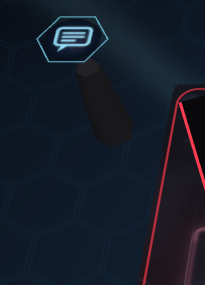
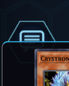
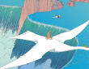
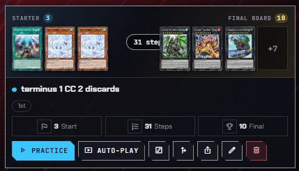
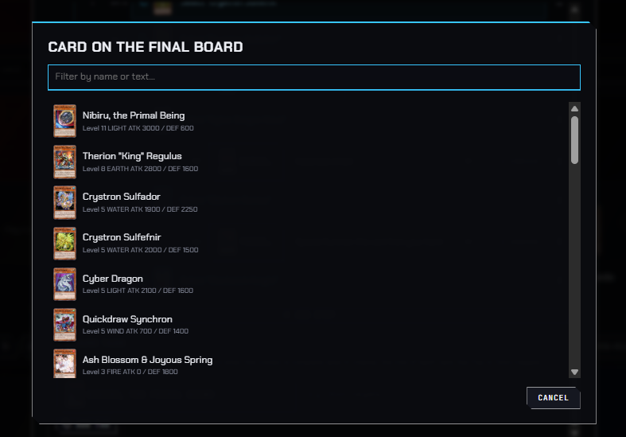
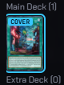
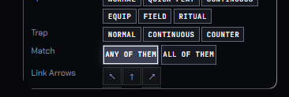

# Bug Reports

Tre sezioni:
1. **Da correggere**: bug ancora aperti.
2. **Corretti, da testare**: corretti, da provare da noi. Claude può spostare qui un bug quando lo corregge.
3. **Corretti e verificati**: provati da noi. Solo noi spostiamo qui un bug, Claude mai.

---

## 1. Da correggere

Nessun bug aperto.

---

## 2. Corretti, da testare

### Duello
- [ ] **Carte rivelate della mano avversaria**: le carte che rivelano o guardano la mano dell'avversario appaiono coperte e non vengono mostrate quando dovrebbero essere rivelate.
- [ ] **Carte avversarie orientate verso di lui**: le carte dell'avversario sul campo devono essere girate verso di lui, altrimenti si confondono.
- [ ] **Bottone Log e Chat inclinato su Windows**:  su Windows il bottone che apre log e chat appare inclinato con "Tilted view in the Duel (like Master Duel) instead of from above"; dovrebbe stare sopra il campo, dritto.
- [ ] **Contorno di Deck ed Extra Deck vuoti**:  completare il contorno del Deck e dell'Extra Deck quando l'avversario non ha Deck o Extra Deck, con "Tilted view in the Duel (like Master Duel) instead of from above" attiva.
- [ ] **Carte nel popup**: durante le partite le carte non appaiono nel popup a meno che non siano sul campo.
- [ ] **Carte in mano tra un Test Duel e l'altro**: il numero di carte in mano si azzera tra un Test Duel e il successivo.
- [ ] **Bottone del log coperto dalla carta**:  alzare il bottone che apre il log, perché viene coperto dalla schermata della carta come in figura.
- [ ] **Livello modificato non visibile**: sul campo non si vede il livello di un mostro se è stato modificato da un effetto.

### Combo Trainer
- [ ] **Editor che torna in cima**: l'editor delle combo torna in cima alla combo ogni volta che si cancella un substep.
- [ ] **Auto mode istantanea**: se si abilita l'auto mode dopo aver modificato una combo a mano (in questo caso togliendo le zone selezionate), la combo avviene istantaneamente.
- [ ] **Special Summon doppio nell'Extra Deck**:  la scritta Special Summon appare due volte nell'Extra Deck; causa non chiara (forse perché il mostro da evocare è un rank-up).
- [ ] **Quick effect sbagliato in auto mode**: quando un mostro ha due quick effect, in auto mode il Trainer può scegliere quello sbagliato; esempio Drastea sul campo nella seguente combo: HELIOS-COMBO:eyJ2IjozLCJuYW1lIjoidGVybWludXMgMSBDQyAyIGRpc2NhcmRzIiwiZmlyc3QiOnRydWUsImhhbmQiOlsyNTY2MTc0Myw0MjE0MTQ5Myw0MjE0MTQ5M10sInN0ZXBzIjpbeyJraW5kIjoiYWN0aXZhdGUiLCJjb2RlIjoyNTY2MTc0MywiZGV0YWlscyI6W3sidCI6InpvbmUiLCJwbGFjZXMiOlt7Im1pbmUiOnRydWUsImxvYyI6InMiLCJzZXEiOjN9XX0seyJ0IjoiY2FyZHMiLCJjb2RlcyI6WzgxNjUwNjk1XSwiZGVjayI6WzgxNjUwNjk1XX0seyJ0IjoieWVzbm8iLCJ5ZXMiOnRydWV9LHsidCI6ImNhcmRzIiwiY29kZXMiOls5NzU1NjMzNl0sImRlY2siOls5NzU1NjMzNl19XX0seyJraW5kIjoic3VtbW9uIiwiY29kZSI6OTc1NTYzMzYsImRldGFpbHMiOlt7InQiOiJ6b25lIiwicGxhY2VzIjpbeyJtaW5lIjp0cnVlLCJsb2MiOiJtIiwic2VxIjozfV19LHsidCI6Inllc25vIiwieWVzIjp0cnVlLCJjb2RlIjo5NzU1NjMzNn0seyJ0IjoiY2FyZHMiLCJjb2RlcyI6WzcwNDg4ODUxXSwiZGVjayI6WzcwNDg4ODUxXX0seyJ0Ijoib3B0aW9uIiwiZGVzYyI6IjU3MyJ9XX0seyJraW5kIjoiYWN0aXZhdGUiLCJjb2RlIjo3MDQ4ODg1MSwiZGV0YWlscyI6W3sidCI6InpvbmUiLCJwbGFjZXMiOlt7Im1pbmUiOnRydWUsImxvYyI6InMiLCJzZXEiOjR9XX1dfSx7ImtpbmQiOiJhY3RpdmF0ZSIsImNvZGUiOjcwNDg4ODUxLCJkZXRhaWxzIjpbeyJ0Ijoib3B0aW9uIiwiZGVzYyI6IjczOTEyOTE3NDI2MTgwIn0seyJ0IjoiY2FyZHMiLCJjb2RlcyI6WzgxNjUwNjk1XX0seyJ0Ijoiem9uZSIsInBsYWNlcyI6W3sibWluZSI6dHJ1ZSwibG9jIjoibSIsInNlcSI6Mn1dfSx7InQiOiJwb3MiLCJwb3MiOjR9LHsidCI6Inllc25vIiwieWVzIjp0cnVlLCJjb2RlIjo3MDQ4ODg1MX0seyJ0IjoiY2FyZHMiLCJjb2RlcyI6WzQzODcxMTY1XSwiZGVjayI6WzQzODcxMTY1XX1dfSx7ImtpbmQiOiJhY3RpdmF0ZSIsImNvZGUiOjgxNjUwNjk1LCJkZXRhaWxzIjpbeyJ0IjoiY2FyZHMiLCJjb2RlcyI6Wzk3NTU2MzM2XX0seyJ0IjoiY2FyZHMiLCJjb2RlcyI6WzMxMDEwMDgxXX0seyJ0Ijoiem9uZSIsInBsYWNlcyI6W3sibWluZSI6dHJ1ZSwibG9jIjoibSIsInNlcSI6M31dfSx7InQiOiJwb3MiLCJwb3MiOjF9LHsidCI6InpvbmUiLCJwbGFjZXMiOlt7Im1pbmUiOnRydWUsImxvYyI6InMiLCJzZXEiOjN9XX0seyJ0IjoieWVzbm8iLCJ5ZXMiOmZhbHNlLCJjb2RlIjozMTAxMDA4MX1dfSx7ImtpbmQiOiJzcHN1bW1vbiIsImNvZGUiOjY1ODQ4MTEzLCJkZXRhaWxzIjpbeyJ0IjoiY2FyZHMiLCJjb2RlcyI6WzMxMDEwMDgxXX0seyJ0Ijoiem9uZSIsInBsYWNlcyI6W3sibWluZSI6dHJ1ZSwibG9jIjoibSIsInNlcSI6M31dfSx7InQiOiJwb3MiLCJwb3MiOjF9LHsidCI6Inllc25vIiwieWVzIjp0cnVlLCJjb2RlIjo4MTY1MDY5NX0seyJ0IjoiY2FyZHMiLCJjb2RlcyI6WzMyNDQyMDE3XSwiZGVjayI6WzMyNDQyMDE3XX1dfSx7ImtpbmQiOiJhY3RpdmF0ZSIsImNvZGUiOjY1ODQ4MTEzLCJkZXRhaWxzIjpbeyJ0IjoiY2FyZHMiLCJjb2RlcyI6Wzk3NTU2MzM2XX0seyJ0IjoiY2FyZHMiLCJjb2RlcyI6WzM4MDA3NjQ5XSwiZGVjayI6WzM4MDA3NjQ5XX0seyJ0IjoieWVzbm8iLCJ5ZXMiOmZhbHNlfV19LHsia2luZCI6ImFjdGl2YXRlIiwiY29kZSI6MzI0NDIwMTcsImRldGFpbHMiOlt7InQiOiJ6b25lIiwicGxhY2VzIjpbeyJtaW5lIjp0cnVlLCJsb2MiOiJzIiwic2VxIjozfV19XX0seyJraW5kIjoiYWN0aXZhdGUiLCJjb2RlIjozMjQ0MjAxNywiZGV0YWlscyI6W3sidCI6ImNhcmRzIiwiY29kZXMiOls2NTg0ODExM119LHsidCI6ImNhcmRzIiwiY29kZXMiOls1NDI2NTk4MF0sImRlY2siOls1NDI2NTk4MF19LHsidCI6Im9wdGlvbiIsImRlc2MiOiIzNDAxNzkyMDQxNzc5NSJ9LHsidCI6InpvbmUiLCJwbGFjZXMiOlt7Im1pbmUiOnRydWUsImxvYyI6Im0iLCJzZXEiOjJ9XX0seyJ0IjoicG9zIiwicG9zIjo0fV19LHsia2luZCI6ImFjdGl2YXRlIiwiY29kZSI6NjU4NDgxMTN9LHsia2luZCI6ImFjdGl2YXRlIiwiY29kZSI6NTQyNjU5ODAsImRldGFpbHMiOlt7InQiOiJjYXJkcyIsImNvZGVzIjpbODQwNTQ1NTZdLCJkZWNrIjpbODQwNTQ1NTZdfSx7InQiOiJ6b25lIiwicGxhY2VzIjpbeyJtaW5lIjp0cnVlLCJsb2MiOiJzIiwic2VxIjoyfV19LHsidCI6ImNhcmRzIiwiY29kZXMiOlsyODg3NzM4Ml0sImRlY2siOlsyODg3NzM4Ml19LHsidCI6InpvbmUiLCJwbGFjZXMiOlt7Im1pbmUiOnRydWUsImxvYyI6Im0iLCJzZXEiOjN9XX0seyJ0IjoicG9zIiwicG9zIjoxfSx7InQiOiJ5ZXNubyIsInllcyI6dHJ1ZSwiY29kZSI6Mjg4NzczODJ9LHsidCI6ImNhcmRzIiwiY29kZXMiOls5MjQ3MjI3M10sImRlY2siOls5MjQ3MjI3M119XX0seyJraW5kIjoic3BzdW1tb24iLCJjb2RlIjo0ODI4NTc2OCwiZGV0YWlscyI6W3sidCI6InBpY2siLCJjb2RlIjo1NDI2NTk4MH0seyJ0IjoicGljayIsImNvZGUiOjI4ODc3MzgyfSx7InQiOiJ6b25lIiwicGxhY2VzIjpbeyJtaW5lIjp0cnVlLCJsb2MiOiJtIiwic2VxIjoyfV19LHsidCI6InBvcyIsInBvcyI6MX1dfSx7ImtpbmQiOiJzcHN1bW1vbiIsImNvZGUiOjExMTMyNjc0LCJkZXRhaWxzIjpbeyJ0IjoiY2FyZHMiLCJjb2RlcyI6WzQ4Mjg1NzY4XX0seyJ0Ijoiem9uZSIsInBsYWNlcyI6W3sibWluZSI6dHJ1ZSwibG9jIjoibSIsInNlcSI6Mn1dfSx7InQiOiJwb3MiLCJwb3MiOjF9XX0seyJraW5kIjoiYWN0aXZhdGUiLCJjb2RlIjoxMTEzMjY3NCwiZGV0YWlscyI6W3sidCI6ImNhcmRzIiwiY29kZXMiOlsxMDYwNDY0NF0sImRlY2siOlsxMDYwNDY0NF19XX0seyJraW5kIjoiYWN0aXZhdGUiLCJjb2RlIjoxMDYwNDY0NCwiZGV0YWlscyI6W3sidCI6ImNhcmRzIiwiY29kZXMiOls2NTg0ODExM119LHsidCI6InpvbmUiLCJwbGFjZXMiOlt7Im1pbmUiOnRydWUsImxvYyI6Im0iLCJzZXEiOjB9XX0seyJ0IjoicG9zIiwicG9zIjoxfSx7InQiOiJ6b25lIiwicGxhY2VzIjpbeyJtaW5lIjp0cnVlLCJsb2MiOiJzIiwic2VxIjowfV19XX0seyJraW5kIjoiYWN0aXZhdGUiLCJjb2RlIjo5MjQ3MjI3MywiZGV0YWlscyI6W3sidCI6ImNhcmRzIiwiY29kZXMiOls2NTg0ODExM119LHsidCI6InpvbmUiLCJwbGFjZXMiOlt7Im1pbmUiOnRydWUsImxvYyI6Im0iLCJzZXEiOjF9XX0seyJ0IjoicG9zIiwicG9zIjoxfSx7InQiOiJ5ZXNubyIsInllcyI6dHJ1ZX0seyJ0IjoiY2FyZHMiLCJjb2RlcyI6WzY4ODMxNjI1XSwiZGVjayI6WzY4ODMxNjI1XX0seyJ0Ijoiem9uZSIsInBsYWNlcyI6W3sibWluZSI6dHJ1ZSwibG9jIjoicyIsInNlcSI6MH1dfV19LHsia2luZCI6ImFjdGl2YXRlIiwiY29kZSI6MzgwMDc2NDksImRldGFpbHMiOlt7InQiOiJ6b25lIiwicGxhY2VzIjpbeyJtaW5lIjp0cnVlLCJsb2MiOiJzIiwic2VxIjo0fV19XX0seyJraW5kIjoiYWN0aXZhdGUiLCJjb2RlIjo5MjQ3MjI3MywiZGV0YWlscyI6W3sidCI6ImNhcmRzIiwiY29kZXMiOlszODAwNzY0OV19LHsidCI6ImNhcmRzIiwiY29kZXMiOls4MDMyMDg3N10sImRlY2siOls4MDMyMDg3N119XX0seyJraW5kIjoiYWN0aXZhdGUiLCJjb2RlIjo4MDMyMDg3NywiZGV0YWlscyI6W3sidCI6ImNhcmRzIiwiY29kZXMiOls5MjQ3MjI3M119XX0seyJraW5kIjoiYWN0aXZhdGUiLCJjb2RlIjozODAwNzY0OSwiZGV0YWlscyI6W3sidCI6ImNhcmRzIiwiY29kZXMiOls4MDMyMDg3N119LHsidCI6Inllc25vIiwieWVzIjp0cnVlfSx7InQiOiJjYXJkcyIsImNvZGVzIjpbNDM4NzExNjVdfSx7InQiOiJ6b25lIiwicGxhY2VzIjpbeyJtaW5lIjp0cnVlLCJsb2MiOiJtIiwic2VxIjozfV19LHsidCI6InBvcyIsInBvcyI6NH0seyJ0IjoiY2FyZHMiLCJjb2RlcyI6WzQzODcxMTY1XSwiZGVjayI6WzQzODcxMTY1XX0seyJ0Ijoiem9uZSIsInBsYWNlcyI6W3sibWluZSI6dHJ1ZSwibG9jIjoicyIsInNlcSI6MX1dfV19LHsia2luZCI6ImFjdGl2YXRlIiwiY29kZSI6ODQwNTQ1NTYsImRldGFpbHMiOlt7InQiOiJjYXJkcyIsImNvZGVzIjpbOTI0NzIyNzNdfV19LHsia2luZCI6InNwc3VtbW9uIiwiY29kZSI6NjgyMzEyODcsImRldGFpbHMiOlt7InQiOiJjYXJkcyIsImNvZGVzIjpbOTI0NzIyNzNdfSx7InQiOiJ6b25lIiwicGxhY2VzIjpbeyJtaW5lIjp0cnVlLCJsb2MiOiJtIiwic2VxIjoxfV19LHsidCI6InBvcyIsInBvcyI6MX1dfSx7ImtpbmQiOiJhY3RpdmF0ZSIsImNvZGUiOjQzODcxMTY1fSx7ImtpbmQiOiJhY3RpdmF0ZSIsImNvZGUiOjY4MjMxMjg3LCJkZXRhaWxzIjpbeyJ0IjoiY2FyZHMiLCJjb2RlcyI6WzY4ODMxNjI1LDg0MDU0NTU2XX0seyJ0Ijoiem9uZSIsInBsYWNlcyI6W3sibWluZSI6dHJ1ZSwibG9jIjoicyIsInNlcSI6MH1dfSx7InQiOiJ6b25lIiwicGxhY2VzIjpbeyJtaW5lIjp0cnVlLCJsb2MiOiJzIiwic2VxIjoxfV19LHsidCI6ImNhcmRzIiwiY29kZXMiOls1MTY2OTg0N10sImRlY2siOls1MTY2OTg0N119XX0seyJraW5kIjoiYWN0aXZhdGUiLCJjb2RlIjo1MTY2OTg0N30seyJraW5kIjoiYWN0aXZhdGUiLCJjb2RlIjo1MTY2OTg0NywiZGV0YWlscyI6W3sidCI6ImNhcmRzIiwiY29kZXMiOls2ODIzMTI4N119LHsidCI6ImNhcmRzIiwiY29kZXMiOls0MjE0MTQ5M119LHsidCI6ImNhcmRzIiwiY29kZXMiOls0Mzg3MTE2NV0sImRlY2siOls0Mzg3MTE2NV19LHsidCI6Im9wdGlvbiIsImRlc2MiOiI1NDE3OTc2MTQ4Nzg3NCJ9LHsidCI6InpvbmUiLCJwbGFjZXMiOlt7Im1pbmUiOnRydWUsImxvYyI6Im0iLCJzZXEiOjR9XX0seyJ0IjoicG9zIiwicG9zIjo0fV19LHsia2luZCI6InNwc3VtbW9uIiwiY29kZSI6NTY5MTAxNjcsImRldGFpbHMiOlt7InQiOiJwaWNrIiwiY29kZSI6NDM4NzExNjV9LHsidCI6InBpY2siLCJjb2RlIjo0Mzg3MTE2NX0seyJ0Ijoiem9uZSIsInBsYWNlcyI6W3sibWluZSI6dHJ1ZSwibG9jIjoibSIsInNlcSI6NH1dfSx7InQiOiJwb3MiLCJwb3MiOjF9XX0seyJraW5kIjoic3BzdW1tb24iLCJjb2RlIjo5MjM1OTQwOSwiZGV0YWlscyI6W3sidCI6ImNhcmRzIiwiY29kZXMiOls1NjkxMDE2N119LHsidCI6InBpY2siLCJjb2RlIjo0MjE0MTQ5M30seyJ0Ijoiem9uZSIsInBsYWNlcyI6W3sibWluZSI6dHJ1ZSwibG9jIjoibSIsInNlcSI6NH1dfSx7InQiOiJwb3MiLCJwb3MiOjF9XX0seyJraW5kIjoiYWN0aXZhdGUiLCJjb2RlIjo2ODIzMTI4NywiZGV0YWlscyI6W3sidCI6ImNhcmRzIiwiY29kZXMiOls5MjQ3MjI3M119LHsidCI6ImNhcmRzIiwiY29kZXMiOls5MjQ3MjI3M119LHsidCI6InpvbmUiLCJwbGFjZXMiOlt7Im1pbmUiOnRydWUsImxvYyI6Im0iLCJzZXEiOjN9XX0seyJ0IjoicG9zIiwicG9zIjoxfSx7InQiOiJ5ZXNubyIsInllcyI6ZmFsc2V9LHsidCI6Inllc25vIiwieWVzIjp0cnVlLCJjb2RlIjoxMTEzMjY3NH0seyJ0IjoiY2FyZHMiLCJjb2RlcyI6WzY4ODMxNjI1XX0seyJ0Ijoib3B0aW9uIiwiZGVzYyI6IjExNjczNDU0NzcyMjI4In1dfSx7ImtpbmQiOiJhY3RpdmF0ZSIsImNvZGUiOjY4ODMxNjI1LCJkZXRhaWxzIjpbeyJ0Ijoiem9uZSIsInBsYWNlcyI6W3sibWluZSI6dHJ1ZSwibG9jIjoicyIsInNlcSI6Mn1dfSx7InQiOiJjYXJkcyIsImNvZGVzIjpbOTI0NzIyNzNdfV19LHsia2luZCI6InNldCIsImNvZGUiOjgwMzIwODc3LCJkZXRhaWxzIjpbeyJ0Ijoiem9uZSIsInBsYWNlcyI6W3sibWluZSI6dHJ1ZSwibG9jIjoicyIsInNlcSI6NH1dfV19XSwiaW50ZXJydXB0cyI6W10sInRhZ3MiOltdLCJjYXJkcyI6eyJtYWluIjpbNzA0ODg4NTEsNDM4NzExNjUsNDM4NzExNjUsNDM4NzExNjUsOTI0NzIyNzMsOTI0NzIyNzMsOTI0NzIyNzMsMTA2MDQ2NDQsMzM4NTQ2MjQsMjg4NzczODIsMjg4NzczODIsMjg4NzczODIsNTQyNjU5ODAsNTQyNjU5ODAsNTQyNjU5ODAsNDIxNDE0OTMsNDIxNDE0OTMsNDIxNDE0OTMsODQxOTI1ODAsODQxOTI1ODAsODQxOTI1ODAsMTQ1NTgxMjcsMTQ1NTgxMjcsMTQ1NTgxMjcsOTQxNDUwMjEsODE2NTA2OTUsMzgwMDc2NDksMzgwMDc2NDksMzgwMDc2NDksODQwNTQ1NTYsNjg4MzE2MjUsMzI0NDIwMTcsMzI0NDIwMTcsMzI0NDIwMTcsNTE2Njk4NDcsMjU2NjE3NDMsNDgxMzAzOTcsNDgxMzAzOTcsNDgxMzAzOTcsODAzMjA4NzcsOTc1NTYzMzYsOTc1NTYzMzYsOTc1NTYzMzZdLCJleHRyYSI6WzEzMjQzMTI0LDExNzY1ODMyLDU0NzU3NzU4LDY4MjMxMjg3LDY4MjMxMjg3LDU2OTEwMTY3LDkyMzU5NDA5LDk1NjI2MzgyLDk1NjI2MzgyLDExMTMyNjc0LDY1ODQ4MTEzLDY1ODQ4MTEzLDMxMDEwMDgxLDMxMDEwMDgxLDQ4Mjg1NzY4XSwic2lkZSI6WzI3MjA0MzExLDI3MjA0MzExLDI3MjA0MzExLDczNjQyMjk2LDczNjQyMjk2LDE4MTQ0NTA3LDE0NTMyMTYzLDE0NTMyMTYzLDE0NTMyMTYzLDQxNDIwMDI3LDQwNjA1MTQ3LDQwNjA1MTQ3LDg0NzQ5ODI0LDg0NzQ5ODI0LDg0NzQ5ODI0XX19
- [ ] **Finestra aperta a fine auto player**: a volte l'auto player del Trainer finisce con una finestra aperta.
- [ ] **Numero dello step non centrato**:  il numero dello step non è centrato e appare mezzo coperto.

### HDPC
- [ ] **Extra Deck in più copie**: aggiungendo una carta a una categoria si apre il deck builder, che mostra ogni carta del deck in una sola copia (giusto), ma le carte dell'Extra Deck appaiono in più copie anche se non dovrebbero.
- [ ] **Descrizione tagliata**: la descrizione della HDPC viene tagliata prima della fine.
- [ ] **Carta in più categorie**: una carta può stare solo in una categoria alla volta, ed è sbagliato.

### Deck builder
- [ ] **Schermate del deck senza deck builder**:  alcune schermate che lavorano sul deck non usano il deck builder.
- [ ] **Carte TCG segnate come OCG**: carte uscite sia in TCG sia in OCG (es. W:P Fancy Ball, Unchained Oni of Shyma) avevano il badge OCG e il nome tradotto dall'OCG, perché il database di ProjectIgnis non le ha ancora aggiornate. Ora, se per YGOPRODeck sono già uscite in TCG, diventano TCG+OCG con nome e testo ufficiali; i dati si rigenerano ogni giorno (1.0.56).
- [ ] **Token di Helios nella ricerca**: le carte personalizzate con "Token look" comparivano cercando "token"; ora, come i Token veri, non compaiono nella ricerca e non entrano nel Deck, ma restano tra le carte collegate (1.0.44).

### Interfaccia
- [ ] **Esc chiudeva anche le finestre sotto**: con due finestre aperte (o il deck builder aperto sopra una finestra) Esc le chiudeva tutte; ora chiude solo quella in cima.
- [ ] **Spazio vuoto e colonne sbilanciate in Settings**: una scheda alta lasciava spazio vuoto sotto le vicine e le schede finivano quasi tutte in una colonna; ora ognuna va nella colonna più corta.
- [ ] **Colore della deck box non applicato**: il colore scelto non arrivava alla scatola (le variabili CSS nello style venivano ignorate).

### Draft
- [ ] **Draft bloccato dopo l'ultima pick**: il draft si ferma del tutto dopo l'ultima pick (trovato contro i bot; uscendo il draft appare ma non si riesce a rientrare). Non riprodotto né in locale né online: ora l'errore compare a schermo, il draft viene salvato e "Rejoin" apre il draft finito. Testare e mandare il messaggio d'errore se ricapita.
- [ ] **Contorno della copertina del bundle**:  quando si sceglie la copertina di un bundle il contorno è in parte offuscato.
- [ ] **Tasto destro nel draft**: durante il draft il tasto destro offriva di uscire dalla pagina invece di aprire la carta cliccata in dettaglio; dopo la correzione scambiare la funzione dei due tasti per un'esperienza più coerente.
- [ ] **More filters non scorre**:  il pannello More filters non si può scorrere e appare tagliato di netto.
- [ ] **Drag and drop delle rarità**: nel draft editor il drag and drop delle rarità delle carte singole smette di funzionare per rarità con molte carte (sulla cinquantina).

---

## 3. Corretti e verificati

### Combo Trainer
- [x] **Carta tagliata in Record a combo**: nella schermata "Record a combo" la carta più a sinistra tra quelle selezionate entrava nel bordo sinistro della finestra.
- [x] **Starting hand sovrapposta in Edit combo**: nella schermata "Edit combo" le combo con troppi step occupavano molto spazio e la finestra della starting hand finiva sopra la decklist, nascondendo le carte.
- [x] **Strict mode e evocazione Pendulum**: la strict mode chiedeva di evocare un mostro specialmente ma non riconosceva che andava fatto con un'evocazione Pendulum.
- [x] **Finestra minimizzata che riappare**: uscendo da una partita in strict mode con una finestra aperta ma minimizzata, la finestra continuava a riapparire sia fuori dalla partita sia iniziandone una nuova.
- [x] **Più precise choice in strict mode**: se una carta aveva più di una "precise choice", la strict mode non costringeva a seguire le istruzioni dopo la prima.
- [x] **Select cards bloccato tornando indietro**: un'attivazione con una "precise choice" di tipo "select cards" non accettava più input se si sceglieva la cosa giusta, si tornava indietro e si provava a riselezionarla.
- [x] **Opzioni degli step solo registrando**: alcune opzioni degli step comparivano registrando una combo ma non nell'editor.
- [x] **Scelta delle carte uniforme nell'editor**: nell'editor c'erano troppi modi diversi di scegliere le carte (finestra del database per "add card" di una "precise choice", menu a tendina per i mostri negli "steps"). Ora c'è ovunque la grafica del database, limitata alle carte della decklist tranne che in "hand trap" e "starting board state", dove si può scegliere qualsiasi carta.

### Duello
- [x] **Mostri normali in mano**: i mostri normali non venivano mostrati correttamente in mano durante le partite.
