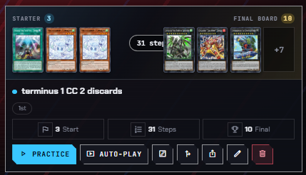

# Bug Reports

- [x] Nella schermata "record a combo" la carta più a sinistra tra le carte selezionate si compenetra con il bordo sinistro dellla finestra.
- [x] Nella schermata "edit combo" le combo con troppi step occupano molto spazio e la finestra della starting hand si compenetra alla finestra della decklist impedendo una visione chiara delle carte.
- [x] Srict mode non chiede di evocare un mostro specialmente ma non riconocse che bisogna farlo tramite un evocazione pendulum.
- [x] Uscendo da una partita del combo trainer in strict mode conuna window aperta ma minimizzata la window continua a riapparire sia fuori dalla partita che se si inizia una nuova.
- [x] Se nel combo trainer una carta ha più di una "precise choice" la strict mode non costringe il giocatore a seguire le istruzioni successive a la prima.
- [x] Nel combo trainer un' attivazione di una carta con una "precise choice" del tipo "select cards" non permette più input se si seleziona la cosa giusta e poi si torna in dietro e si cerca di riselezionarla.
- [x] Esistono delle opzioni per gli steps nel combo trainer che appaiono se si registra una combo ma non dall'editor.
- [x] Nelle varie impostazioni nel combo trainer editor dove è necessario selezionare delle carte ci sono troppi modi diversi di selezionare le suddette, per l'opzione add card di una "precise choice" fa apparire una finestra che permette di selezionare una carta dal database invece se si seleziona un mostro in "steps" lo si può fare da un drop down. Standardizzare tutto con la grafica del database all'interno del combo trainer editor permettendo di usare solo carte nella decklist a sola eccezione della sezione "hand trap" e quella "starting board state" che devono avere la stessa grafica delle altre ma permetter di selezionare comunque qualsiasi carta dal database.
- [x] I mostri normali non vengono mostrati correttamente in mano durante le partite.
- [ ] le carte che rivelano o guardano la mano dell’avversario appaiono face down e non vengono mostrate quando dovrebbero essere rivelate
- [ ] le carte dell’avversario dovrebbero essere orientate verso di loro nel duel field altrimenti si confondono
- [ ] nell’HDPC quando si aggiunge una carta a una categoria apre il deck builder e il deck builder mostra ogni carta del tuo deck come nonocopia (tutto giusto fino a qui) tuttavia le carte dell’extradeck sono mostrate in multipli anche se non dovrebbero
- [ ] Il combo trainer editor torna in cima alla combo ogni volta che si cancella un substep.
- [ ] se si abilita auto mode nel combo trainer dopo aver modificato una combo manualmente (in questo caso levando le zone selezionate) la combo avviene instantaneamente.
- [ ] la descrizione della HDPC viene tagliataprima di finire.
- [ ] le carte nell'HDPC possono essere solo in una categoria alla volta, questo è sbagliato.
- [ ] [alt text](image.png) appare due volte nell'extradeck la scritta special summon non chiara la causa (possibilmente perché il mostro che si sta cercando di evocare è un rank-up).
- [ ] quando un mostro ha 2 quick effect in auto mode il trainer potrebbe scegliere quello sbagliato esempio drastea sul campo nella seguente combo: HELIOS-COMBO:eyJ2IjozLCJuYW1lIjoidGVybWludXMgMSBDQyAyIGRpc2NhcmRzIiwiZmlyc3QiOnRydWUsImhhbmQiOlsyNTY2MTc0Myw0MjE0MTQ5Myw0MjE0MTQ5M10sInN0ZXBzIjpbeyJraW5kIjoiYWN0aXZhdGUiLCJjb2RlIjoyNTY2MTc0MywiZGV0YWlscyI6W3sidCI6InpvbmUiLCJwbGFjZXMiOlt7Im1pbmUiOnRydWUsImxvYyI6InMiLCJzZXEiOjN9XX0seyJ0IjoiY2FyZHMiLCJjb2RlcyI6WzgxNjUwNjk1XSwiZGVjayI6WzgxNjUwNjk1XX0seyJ0IjoieWVzbm8iLCJ5ZXMiOnRydWV9LHsidCI6ImNhcmRzIiwiY29kZXMiOls5NzU1NjMzNl0sImRlY2siOls5NzU1NjMzNl19XX0seyJraW5kIjoic3VtbW9uIiwiY29kZSI6OTc1NTYzMzYsImRldGFpbHMiOlt7InQiOiJ6b25lIiwicGxhY2VzIjpbeyJtaW5lIjp0cnVlLCJsb2MiOiJtIiwic2VxIjozfV19LHsidCI6Inllc25vIiwieWVzIjp0cnVlLCJjb2RlIjo5NzU1NjMzNn0seyJ0IjoiY2FyZHMiLCJjb2RlcyI6WzcwNDg4ODUxXSwiZGVjayI6WzcwNDg4ODUxXX0seyJ0Ijoib3B0aW9uIiwiZGVzYyI6IjU3MyJ9XX0seyJraW5kIjoiYWN0aXZhdGUiLCJjb2RlIjo3MDQ4ODg1MSwiZGV0YWlscyI6W3sidCI6InpvbmUiLCJwbGFjZXMiOlt7Im1pbmUiOnRydWUsImxvYyI6InMiLCJzZXEiOjR9XX1dfSx7ImtpbmQiOiJhY3RpdmF0ZSIsImNvZGUiOjcwNDg4ODUxLCJkZXRhaWxzIjpbeyJ0Ijoib3B0aW9uIiwiZGVzYyI6IjczOTEyOTE3NDI2MTgwIn0seyJ0IjoiY2FyZHMiLCJjb2RlcyI6WzgxNjUwNjk1XX0seyJ0Ijoiem9uZSIsInBsYWNlcyI6W3sibWluZSI6dHJ1ZSwibG9jIjoibSIsInNlcSI6Mn1dfSx7InQiOiJwb3MiLCJwb3MiOjR9LHsidCI6Inllc25vIiwieWVzIjp0cnVlLCJjb2RlIjo3MDQ4ODg1MX0seyJ0IjoiY2FyZHMiLCJjb2RlcyI6WzQzODcxMTY1XSwiZGVjayI6WzQzODcxMTY1XX1dfSx7ImtpbmQiOiJhY3RpdmF0ZSIsImNvZGUiOjgxNjUwNjk1LCJkZXRhaWxzIjpbeyJ0IjoiY2FyZHMiLCJjb2RlcyI6Wzk3NTU2MzM2XX0seyJ0IjoiY2FyZHMiLCJjb2RlcyI6WzMxMDEwMDgxXX0seyJ0Ijoiem9uZSIsInBsYWNlcyI6W3sibWluZSI6dHJ1ZSwibG9jIjoibSIsInNlcSI6M31dfSx7InQiOiJwb3MiLCJwb3MiOjF9LHsidCI6InpvbmUiLCJwbGFjZXMiOlt7Im1pbmUiOnRydWUsImxvYyI6InMiLCJzZXEiOjN9XX0seyJ0IjoieWVzbm8iLCJ5ZXMiOmZhbHNlLCJjb2RlIjozMTAxMDA4MX1dfSx7ImtpbmQiOiJzcHN1bW1vbiIsImNvZGUiOjY1ODQ4MTEzLCJkZXRhaWxzIjpbeyJ0IjoiY2FyZHMiLCJjb2RlcyI6WzMxMDEwMDgxXX0seyJ0Ijoiem9uZSIsInBsYWNlcyI6W3sibWluZSI6dHJ1ZSwibG9jIjoibSIsInNlcSI6M31dfSx7InQiOiJwb3MiLCJwb3MiOjF9LHsidCI6Inllc25vIiwieWVzIjp0cnVlLCJjb2RlIjo4MTY1MDY5NX0seyJ0IjoiY2FyZHMiLCJjb2RlcyI6WzMyNDQyMDE3XSwiZGVjayI6WzMyNDQyMDE3XX1dfSx7ImtpbmQiOiJhY3RpdmF0ZSIsImNvZGUiOjY1ODQ4MTEzLCJkZXRhaWxzIjpbeyJ0IjoiY2FyZHMiLCJjb2RlcyI6Wzk3NTU2MzM2XX0seyJ0IjoiY2FyZHMiLCJjb2RlcyI6WzM4MDA3NjQ5XSwiZGVjayI6WzM4MDA3NjQ5XX0seyJ0IjoieWVzbm8iLCJ5ZXMiOmZhbHNlfV19LHsia2luZCI6ImFjdGl2YXRlIiwiY29kZSI6MzI0NDIwMTcsImRldGFpbHMiOlt7InQiOiJ6b25lIiwicGxhY2VzIjpbeyJtaW5lIjp0cnVlLCJsb2MiOiJzIiwic2VxIjozfV19XX0seyJraW5kIjoiYWN0aXZhdGUiLCJjb2RlIjozMjQ0MjAxNywiZGV0YWlscyI6W3sidCI6ImNhcmRzIiwiY29kZXMiOls2NTg0ODExM119LHsidCI6ImNhcmRzIiwiY29kZXMiOls1NDI2NTk4MF0sImRlY2siOls1NDI2NTk4MF19LHsidCI6Im9wdGlvbiIsImRlc2MiOiIzNDAxNzkyMDQxNzc5NSJ9LHsidCI6InpvbmUiLCJwbGFjZXMiOlt7Im1pbmUiOnRydWUsImxvYyI6Im0iLCJzZXEiOjJ9XX0seyJ0IjoicG9zIiwicG9zIjo0fV19LHsia2luZCI6ImFjdGl2YXRlIiwiY29kZSI6NjU4NDgxMTN9LHsia2luZCI6ImFjdGl2YXRlIiwiY29kZSI6NTQyNjU5ODAsImRldGFpbHMiOlt7InQiOiJjYXJkcyIsImNvZGVzIjpbODQwNTQ1NTZdLCJkZWNrIjpbODQwNTQ1NTZdfSx7InQiOiJ6b25lIiwicGxhY2VzIjpbeyJtaW5lIjp0cnVlLCJsb2MiOiJzIiwic2VxIjoyfV19LHsidCI6ImNhcmRzIiwiY29kZXMiOlsyODg3NzM4Ml0sImRlY2siOlsyODg3NzM4Ml19LHsidCI6InpvbmUiLCJwbGFjZXMiOlt7Im1pbmUiOnRydWUsImxvYyI6Im0iLCJzZXEiOjN9XX0seyJ0IjoicG9zIiwicG9zIjoxfSx7InQiOiJ5ZXNubyIsInllcyI6dHJ1ZSwiY29kZSI6Mjg4NzczODJ9LHsidCI6ImNhcmRzIiwiY29kZXMiOls5MjQ3MjI3M10sImRlY2siOls5MjQ3MjI3M119XX0seyJraW5kIjoic3BzdW1tb24iLCJjb2RlIjo0ODI4NTc2OCwiZGV0YWlscyI6W3sidCI6InBpY2siLCJjb2RlIjo1NDI2NTk4MH0seyJ0IjoicGljayIsImNvZGUiOjI4ODc3MzgyfSx7InQiOiJ6b25lIiwicGxhY2VzIjpbeyJtaW5lIjp0cnVlLCJsb2MiOiJtIiwic2VxIjoyfV19LHsidCI6InBvcyIsInBvcyI6MX1dfSx7ImtpbmQiOiJzcHN1bW1vbiIsImNvZGUiOjExMTMyNjc0LCJkZXRhaWxzIjpbeyJ0IjoiY2FyZHMiLCJjb2RlcyI6WzQ4Mjg1NzY4XX0seyJ0Ijoiem9uZSIsInBsYWNlcyI6W3sibWluZSI6dHJ1ZSwibG9jIjoibSIsInNlcSI6Mn1dfSx7InQiOiJwb3MiLCJwb3MiOjF9XX0seyJraW5kIjoiYWN0aXZhdGUiLCJjb2RlIjoxMTEzMjY3NCwiZGV0YWlscyI6W3sidCI6ImNhcmRzIiwiY29kZXMiOlsxMDYwNDY0NF0sImRlY2siOlsxMDYwNDY0NF19XX0seyJraW5kIjoiYWN0aXZhdGUiLCJjb2RlIjoxMDYwNDY0NCwiZGV0YWlscyI6W3sidCI6ImNhcmRzIiwiY29kZXMiOls2NTg0ODExM119LHsidCI6InpvbmUiLCJwbGFjZXMiOlt7Im1pbmUiOnRydWUsImxvYyI6Im0iLCJzZXEiOjB9XX0seyJ0IjoicG9zIiwicG9zIjoxfSx7InQiOiJ6b25lIiwicGxhY2VzIjpbeyJtaW5lIjp0cnVlLCJsb2MiOiJzIiwic2VxIjowfV19XX0seyJraW5kIjoiYWN0aXZhdGUiLCJjb2RlIjo5MjQ3MjI3MywiZGV0YWlscyI6W3sidCI6ImNhcmRzIiwiY29kZXMiOls2NTg0ODExM119LHsidCI6InpvbmUiLCJwbGFjZXMiOlt7Im1pbmUiOnRydWUsImxvYyI6Im0iLCJzZXEiOjF9XX0seyJ0IjoicG9zIiwicG9zIjoxfSx7InQiOiJ5ZXNubyIsInllcyI6dHJ1ZX0seyJ0IjoiY2FyZHMiLCJjb2RlcyI6WzY4ODMxNjI1XSwiZGVjayI6WzY4ODMxNjI1XX0seyJ0Ijoiem9uZSIsInBsYWNlcyI6W3sibWluZSI6dHJ1ZSwibG9jIjoicyIsInNlcSI6MH1dfV19LHsia2luZCI6ImFjdGl2YXRlIiwiY29kZSI6MzgwMDc2NDksImRldGFpbHMiOlt7InQiOiJ6b25lIiwicGxhY2VzIjpbeyJtaW5lIjp0cnVlLCJsb2MiOiJzIiwic2VxIjo0fV19XX0seyJraW5kIjoiYWN0aXZhdGUiLCJjb2RlIjo5MjQ3MjI3MywiZGV0YWlscyI6W3sidCI6ImNhcmRzIiwiY29kZXMiOlszODAwNzY0OV19LHsidCI6ImNhcmRzIiwiY29kZXMiOls4MDMyMDg3N10sImRlY2siOls4MDMyMDg3N119XX0seyJraW5kIjoiYWN0aXZhdGUiLCJjb2RlIjo4MDMyMDg3NywiZGV0YWlscyI6W3sidCI6ImNhcmRzIiwiY29kZXMiOls5MjQ3MjI3M119XX0seyJraW5kIjoiYWN0aXZhdGUiLCJjb2RlIjozODAwNzY0OSwiZGV0YWlscyI6W3sidCI6ImNhcmRzIiwiY29kZXMiOls4MDMyMDg3N119LHsidCI6Inllc25vIiwieWVzIjp0cnVlfSx7InQiOiJjYXJkcyIsImNvZGVzIjpbNDM4NzExNjVdfSx7InQiOiJ6b25lIiwicGxhY2VzIjpbeyJtaW5lIjp0cnVlLCJsb2MiOiJtIiwic2VxIjozfV19LHsidCI6InBvcyIsInBvcyI6NH0seyJ0IjoiY2FyZHMiLCJjb2RlcyI6WzQzODcxMTY1XSwiZGVjayI6WzQzODcxMTY1XX0seyJ0Ijoiem9uZSIsInBsYWNlcyI6W3sibWluZSI6dHJ1ZSwibG9jIjoicyIsInNlcSI6MX1dfV19LHsia2luZCI6ImFjdGl2YXRlIiwiY29kZSI6ODQwNTQ1NTYsImRldGFpbHMiOlt7InQiOiJjYXJkcyIsImNvZGVzIjpbOTI0NzIyNzNdfV19LHsia2luZCI6InNwc3VtbW9uIiwiY29kZSI6NjgyMzEyODcsImRldGFpbHMiOlt7InQiOiJjYXJkcyIsImNvZGVzIjpbOTI0NzIyNzNdfSx7InQiOiJ6b25lIiwicGxhY2VzIjpbeyJtaW5lIjp0cnVlLCJsb2MiOiJtIiwic2VxIjoxfV19LHsidCI6InBvcyIsInBvcyI6MX1dfSx7ImtpbmQiOiJhY3RpdmF0ZSIsImNvZGUiOjQzODcxMTY1fSx7ImtpbmQiOiJhY3RpdmF0ZSIsImNvZGUiOjY4MjMxMjg3LCJkZXRhaWxzIjpbeyJ0IjoiY2FyZHMiLCJjb2RlcyI6WzY4ODMxNjI1LDg0MDU0NTU2XX0seyJ0Ijoiem9uZSIsInBsYWNlcyI6W3sibWluZSI6dHJ1ZSwibG9jIjoicyIsInNlcSI6MH1dfSx7InQiOiJ6b25lIiwicGxhY2VzIjpbeyJtaW5lIjp0cnVlLCJsb2MiOiJzIiwic2VxIjoxfV19LHsidCI6ImNhcmRzIiwiY29kZXMiOls1MTY2OTg0N10sImRlY2siOls1MTY2OTg0N119XX0seyJraW5kIjoiYWN0aXZhdGUiLCJjb2RlIjo1MTY2OTg0N30seyJraW5kIjoiYWN0aXZhdGUiLCJjb2RlIjo1MTY2OTg0NywiZGV0YWlscyI6W3sidCI6ImNhcmRzIiwiY29kZXMiOls2ODIzMTI4N119LHsidCI6ImNhcmRzIiwiY29kZXMiOls0MjE0MTQ5M119LHsidCI6ImNhcmRzIiwiY29kZXMiOls0Mzg3MTE2NV0sImRlY2siOls0Mzg3MTE2NV19LHsidCI6Im9wdGlvbiIsImRlc2MiOiI1NDE3OTc2MTQ4Nzg3NCJ9LHsidCI6InpvbmUiLCJwbGFjZXMiOlt7Im1pbmUiOnRydWUsImxvYyI6Im0iLCJzZXEiOjR9XX0seyJ0IjoicG9zIiwicG9zIjo0fV19LHsia2luZCI6InNwc3VtbW9uIiwiY29kZSI6NTY5MTAxNjcsImRldGFpbHMiOlt7InQiOiJwaWNrIiwiY29kZSI6NDM4NzExNjV9LHsidCI6InBpY2siLCJjb2RlIjo0Mzg3MTE2NX0seyJ0Ijoiem9uZSIsInBsYWNlcyI6W3sibWluZSI6dHJ1ZSwibG9jIjoibSIsInNlcSI6NH1dfSx7InQiOiJwb3MiLCJwb3MiOjF9XX0seyJraW5kIjoic3BzdW1tb24iLCJjb2RlIjo5MjM1OTQwOSwiZGV0YWlscyI6W3sidCI6ImNhcmRzIiwiY29kZXMiOls1NjkxMDE2N119LHsidCI6InBpY2siLCJjb2RlIjo0MjE0MTQ5M30seyJ0Ijoiem9uZSIsInBsYWNlcyI6W3sibWluZSI6dHJ1ZSwibG9jIjoibSIsInNlcSI6NH1dfSx7InQiOiJwb3MiLCJwb3MiOjF9XX0seyJraW5kIjoiYWN0aXZhdGUiLCJjb2RlIjo2ODIzMTI4NywiZGV0YWlscyI6W3sidCI6ImNhcmRzIiwiY29kZXMiOls5MjQ3MjI3M119LHsidCI6ImNhcmRzIiwiY29kZXMiOls5MjQ3MjI3M119LHsidCI6InpvbmUiLCJwbGFjZXMiOlt7Im1pbmUiOnRydWUsImxvYyI6Im0iLCJzZXEiOjN9XX0seyJ0IjoicG9zIiwicG9zIjoxfSx7InQiOiJ5ZXNubyIsInllcyI6ZmFsc2V9LHsidCI6Inllc25vIiwieWVzIjp0cnVlLCJjb2RlIjoxMTEzMjY3NH0seyJ0IjoiY2FyZHMiLCJjb2RlcyI6WzY4ODMxNjI1XX0seyJ0Ijoib3B0aW9uIiwiZGVzYyI6IjExNjczNDU0NzcyMjI4In1dfSx7ImtpbmQiOiJhY3RpdmF0ZSIsImNvZGUiOjY4ODMxNjI1LCJkZXRhaWxzIjpbeyJ0Ijoiem9uZSIsInBsYWNlcyI6W3sibWluZSI6dHJ1ZSwibG9jIjoicyIsInNlcSI6Mn1dfSx7InQiOiJjYXJkcyIsImNvZGVzIjpbOTI0NzIyNzNdfV19LHsia2luZCI6InNldCIsImNvZGUiOjgwMzIwODc3LCJkZXRhaWxzIjpbeyJ0Ijoiem9uZSIsInBsYWNlcyI6W3sibWluZSI6dHJ1ZSwibG9jIjoicyIsInNlcSI6NH1dfV19XSwiaW50ZXJydXB0cyI6W10sInRhZ3MiOltdLCJjYXJkcyI6eyJtYWluIjpbNzA0ODg4NTEsNDM4NzExNjUsNDM4NzExNjUsNDM4NzExNjUsOTI0NzIyNzMsOTI0NzIyNzMsOTI0NzIyNzMsMTA2MDQ2NDQsMzM4NTQ2MjQsMjg4NzczODIsMjg4NzczODIsMjg4NzczODIsNTQyNjU5ODAsNTQyNjU5ODAsNTQyNjU5ODAsNDIxNDE0OTMsNDIxNDE0OTMsNDIxNDE0OTMsODQxOTI1ODAsODQxOTI1ODAsODQxOTI1ODAsMTQ1NTgxMjcsMTQ1NTgxMjcsMTQ1NTgxMjcsOTQxNDUwMjEsODE2NTA2OTUsMzgwMDc2NDksMzgwMDc2NDksMzgwMDc2NDksODQwNTQ1NTYsNjg4MzE2MjUsMzI0NDIwMTcsMzI0NDIwMTcsMzI0NDIwMTcsNTE2Njk4NDcsMjU2NjE3NDMsNDgxMzAzOTcsNDgxMzAzOTcsNDgxMzAzOTcsODAzMjA4NzcsOTc1NTYzMzYsOTc1NTYzMzYsOTc1NTYzMzZdLCJleHRyYSI6WzEzMjQzMTI0LDExNzY1ODMyLDU0NzU3NzU4LDY4MjMxMjg3LDY4MjMxMjg3LDU2OTEwMTY3LDkyMzU5NDA5LDk1NjI2MzgyLDk1NjI2MzgyLDExMTMyNjc0LDY1ODQ4MTEzLDY1ODQ4MTEzLDMxMDEwMDgxLDMxMDEwMDgxLDQ4Mjg1NzY4XSwic2lkZSI6WzI3MjA0MzExLDI3MjA0MzExLDI3MjA0MzExLDczNjQyMjk2LDczNjQyMjk2LDE4MTQ0NTA3LDE0NTMyMTYzLDE0NTMyMTYzLDE0NTMyMTYzLDQxNDIwMDI3LDQwNjA1MTQ3LDQwNjA1MTQ3LDg0NzQ5ODI0LDg0NzQ5ODI0LDg0NzQ5ODI0XX19
- [ ] a volte il trainer auto player finisce con una window aperta.
- [ ]  bug visuale; il numero di step non è centrato e appare mezzo coperto.

